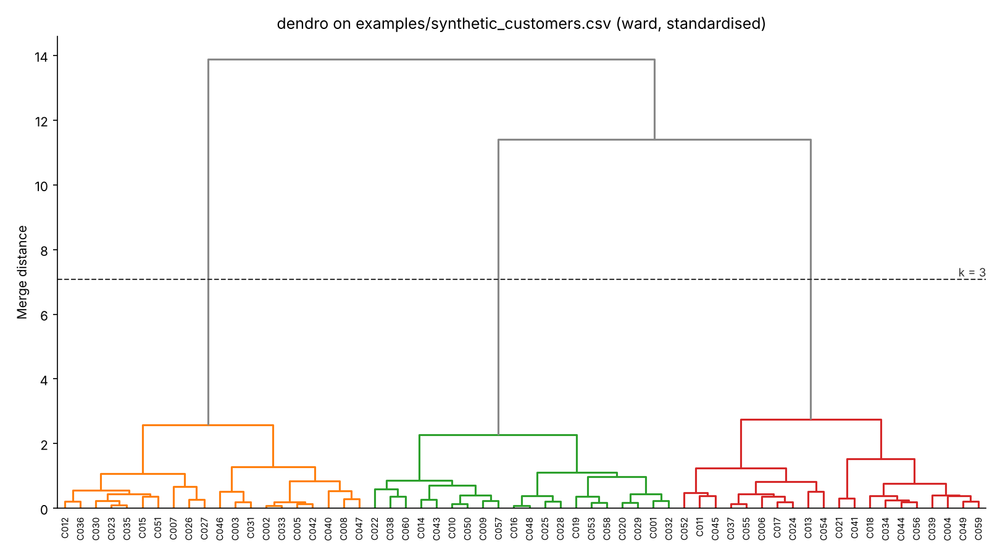
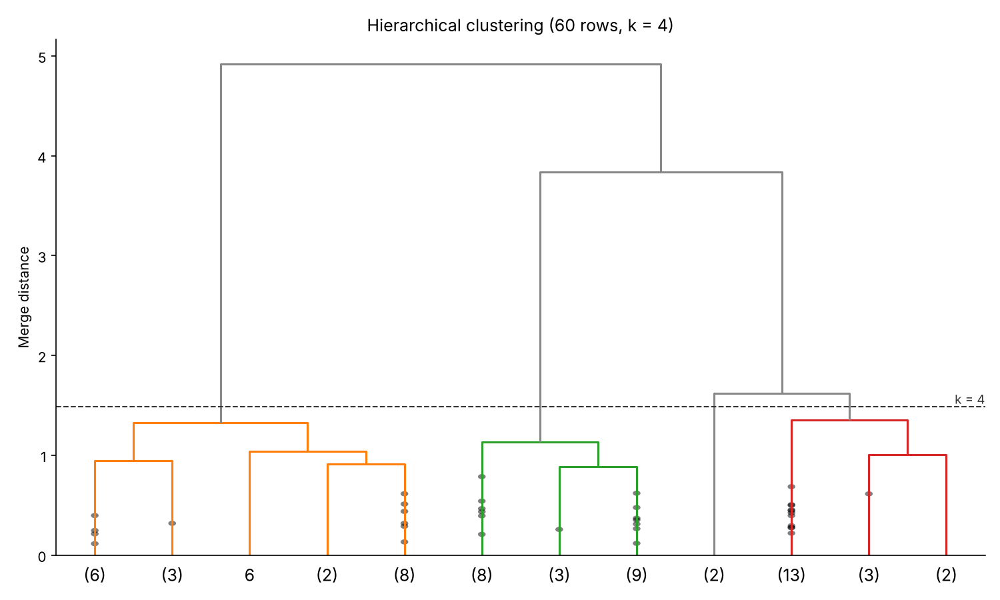

# dendro - hierarchical clustering & dendrograms for any CSV

> **About the repo name:** this repository is called `dendogram`, keeping its original
> spelling. The correct term is **dendrogram**; the folder is intentionally not renamed so
> existing links keep working. The tool itself is called `dendro`.

`dendro` is a small, reusable command-line tool that takes **any CSV file** and:

1. selects the numeric columns (or the ones you name),
2. optionally scales them (z-score by default, min-max, or none),
3. runs **agglomerative hierarchical clustering** with SciPy using the linkage and distance
   metric you choose,
4. picks the number of clusters **k automatically** by the best mean
   [silhouette score](https://scikit-learn.org/stable/modules/clustering.html#silhouette-coefficient)
   (or uses the `k` you give),
5. saves a **dendrogram PNG** coloured by cluster with the cut line drawn, and
6. writes the CSV back with a new **`cluster` column**.



## Features

- Works on any CSV: non-numeric and boolean columns are ignored automatically; pick
  columns with `--columns`, drop some with `--exclude`, label leaves with `--id-column`.
- Linkages: `ward` (default), `complete`, `average`, `single`, `weighted`, `centroid`,
  `median`. Metrics: `euclidean`, `sqeuclidean`, `cityblock`, `chebyshev`, `cosine`,
  `correlation` (invalid combinations such as `ward` + `cosine` are rejected with a clear error).
- Automatic k in a configurable range (`--k-min`, `--k-max`); silhouette is evaluated with
  the same metric used for clustering.
- Rows with missing values in the chosen features are skipped and get an empty cluster
  value in the output, so the output has exactly the same rows as the input.
- `--truncate P` shows only the last P merges for large datasets.
- Headless (matplotlib Agg backend) - works on servers and in CI.

## Installation

Requires Python 3.10+.

```bash
git clone https://github.com/ariaesm/dendogram.git
cd dendogram
pip install .          # installs the `dendro` command
# or, without installing: pip install -r requirements.txt && python -m dendro ...
```

## Usage

`examples/synthetic_customers.csv` is a **synthetic** dataset (60 rows) generated by
[`examples/make_sample.py`](examples/make_sample.py) with scikit-learn's `make_blobs`
(3 groups, fixed seed). Its `segment` column holds the true group; being text, it is
ignored for clustering, which makes it easy to check the result.

The outputs below are real, copied from running the commands in this repository.

### Automatic k

```console
$ dendro examples/synthetic_customers.csv --id-column customer_id \
    --plot docs/dendrogram.png -o examples/synthetic_customers_clustered.csv \
    --title "dendro on examples/synthetic_customers.csv (ward, standardised)"
Rows: 60 used, 0 skipped (missing values)
Features (3): annual_spend, visits_per_month, avg_basket
Scaling: standard | linkage: ward | metric: euclidean
Silhouette by k:
  k=2   0.539
  k=3   0.725  <- best
  k=4   0.612
  k=5   0.514
  k=6   0.400
  k=7   0.399
  k=8   0.380
  k=9   0.368
  k=10  0.348
Clusters: k=3 (auto), silhouette=0.725
Cluster sizes: 1: 20, 2: 20, 3: 20
Wrote examples/synthetic_customers_clustered.csv
Wrote docs/dendrogram.png
```

```console
$ head -4 examples/synthetic_customers_clustered.csv
customer_id,segment,annual_spend,visits_per_month,avg_basket,cluster
C001,B,2073.0,14.5,45.24,2
C002,C,1414.0,2.0,22.44,1
C003,C,1292.0,1.2,17.07,1
```

The three true segments are recovered exactly (each `segment` maps to one `cluster`;
this is also asserted in the tests).

### Fixed k, other linkage/metric, truncated plot

```console
$ dendro examples/synthetic_customers.csv -m average --metric cityblock -k 4 \
    --truncate 12 -p docs/dendrogram_average_k4.png -o avg.csv
Rows: 60 used, 0 skipped (missing values)
Features (3): annual_spend, visits_per_month, avg_basket
Scaling: standard | linkage: average | metric: cityblock
Clusters: k=4 (user), silhouette=0.630
Cluster sizes: 1: 20, 2: 20, 3: 2, 4: 18
Wrote avg.csv
Wrote docs/dendrogram_average_k4.png
```



### All options

```text
dendro CSV [-c COLUMNS] [-x EXCLUDE] [--id-column COL] [--sep SEP]
           [--scale {standard,minmax,none}]
           [-m {single,complete,average,weighted,centroid,median,ward}]
           [--metric {euclidean,sqeuclidean,cityblock,chebyshev,cosine,correlation}]
           [-k K] [--k-min K_MIN] [--k-max K_MAX]
           [-o OUTPUT] [--cluster-column NAME]
           [-p PLOT] [--no-plot] [--truncate P] [--title TITLE]
```

Defaults: output `<input>_clustered.csv`, plot `<input>.png`, `--scale standard`,
`-m ward`, `--metric euclidean`, k chosen in 2..10.

### As a library

```python
import pandas as pd
from dendro.core import run, attach_labels

df = pd.read_csv("examples/synthetic_customers.csv")
result = run(df, method="ward")  # or k=4, columns=[...], scaling="minmax", ...
print(result.k, result.selection.scores)
labelled = attach_labels(df, result)  # adds the "cluster" column
```

## How k is chosen

For every k in `[k-min, k-max]` the tree is cut into k flat clusters
(`scipy.cluster.hierarchy.fcluster(..., criterion="maxclust")`) and the mean silhouette
coefficient is computed on the scaled features. The k with the highest score wins (ties go
to the smaller k). Silhouette favours compact, well-separated clusters; it is a heuristic,
so look at the dendrogram too and override with `-k` when domain knowledge says otherwise.

## Tests

```bash
python -m pytest -q
```

CI (GitHub Actions) runs `ruff` and `pytest` on Python 3.12.

## License

MIT - see [LICENSE](LICENSE).
